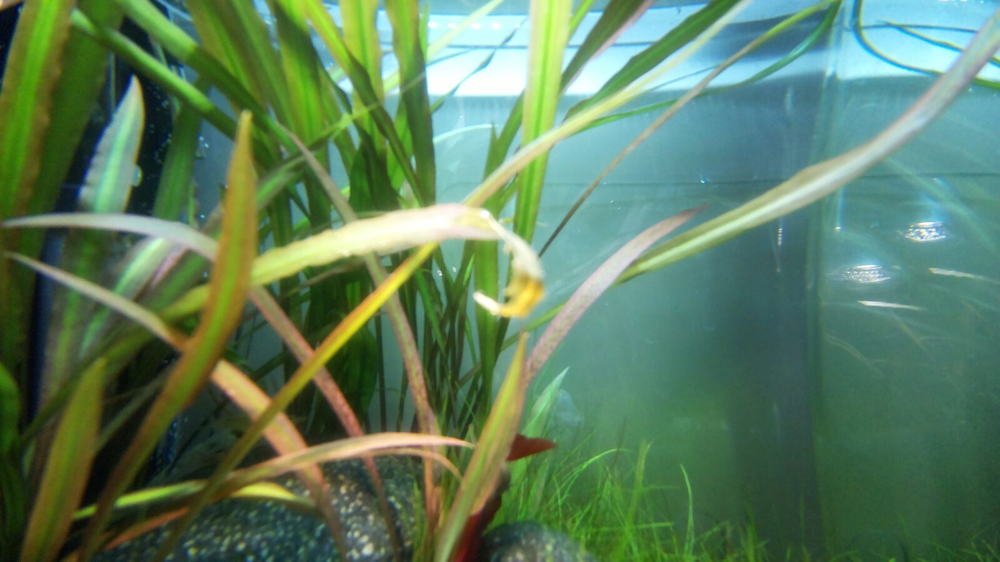

# 2026-11-10

## Camera tray: second print fits, Pi booted in it, first fixed frame

**First print (overnight) failed on fit**: the boards bound on the pins and
the lid fell off. Both are tolerance lessons for this printer, not design
errors. Single-pin coupons passed because one pin at nominal has slack to
wander; four pins at once share one position error, and tall thin pins
print fat at the top (too little cooling time per layer). The lid lip at
0.2mm offset was "very loose — doesn't hold at all"; Tom's original 0.1
was right.

**Changes for print two** (checked on the exports `case(5)` / `lid(6)`):

- Pins Ø2.55 (Pi) / Ø2.0 (camera), i.e. ~0.2 under the hole, on Ø5×2 and
  Ø4.5×8 bosses; lid bores Ø3.05 / Ø2.5 (0.25 radial over the pin — Tom
  pushed back on my 0.4, rightly: that's half the tube). Camera tubes
  Ø4.5 with a 0.5mm×60° entry chamfer, leaving a 0.4mm landing ring.
- Lid lip back to 0.1 offset, retained by two friction bumps on the lid
  lip (0.3 proud, 20mm long, filleted, mid-length each long side) — a
  0.2mm squeeze per side.
- Measured on the real boards: camera PCB ~0.8mm, Pi PCB 1.0mm; tubes sized
  so the lid bottoms on the boards, not on the lip.
- Slicer: slow small features (Filament → Cooling min layer time ~8–10s,
  Process → Speed → small perimeters) so pin tops stay round.

**Print two fits**: boards drop onto the pins, lid holds, Pi boots in the
tray. Propped against the glass (no hook yet) and `grab-frame.sh --
--rotation 180 --shutter 6000` gives an upright, sharp frame with **no
vignetting** at 102° through the chamfered window — the 1.2mm lens recess
and the 45° flare both work. Frame was aimed too low (propped at substrate
level); framing is the hook's job.

**Hook design (separate part, not printed yet)**: a 15.4mm-wide notch in
the top end wall from floor to rim; the hook's foot (15×12×1.5mm, two
Ø3.25 holes) drops over two Ø2.75×1.5 floor pins under the Pi, so the Pi
board and lid tubes trap it; the neck steps up 1.5mm just outside the wall
so it lies in the glass plane; crown and 10mm return over the rim. Printed
on its side so the bends are in-layer — no ribs needed. One-piece case +
hook was rejected: the return leg can't print flat with the tray.

→ updated memory/pending.md (Mount: print status, pin/lid sizes, hook)

## Hook printed; camera hanging on the side pane

Evening: the notched case (`case(8)`) and a short test hook (`hook(4)`)
printed and the tray is **hanging on the tank for the first time**.
Hook as built: foot 7×31×2mm with Ø4.9 holes dropping over the Ø4.5 Pi
bosses (foot replaced the earlier floor-pin idea — the Pi and lid tubes
clamp it, nothing new on the case); 8mm neck through an 8.5mm notch in
the end wall, 3mm thick outside the wall with its underside flush with
the glass face; 1.5mm crown, 5.2mm rim slot (0.2 over the 5mm glass,
deliberate), 5mm return. Printed flat, top face down, supports only
under the return — the 31mm foot bar makes "profile on the bed"
impossible, which I had wrongly assumed. Lid(10) adds end bumps (0.3
proud) to stop the lid sliding along the case; plate going 1.5→2mm
against a slight bow.

Three positions tried with `grab-frame.sh -- --rotation 180 --shutter
6000`: front-left is full of hardware (lily pipe, lamp), front-centre
and the **side pane** are clean. Side pane chosen, shifted toward the
planted end: plants fill ~⅔, substrate along the bottom, the far pane
shows the room on the right (backing card would fix it). Water line
just clips the top edge, so the real hook gets a **20mm longer neck**.
Full-sensor 4608×2592 is the widest mode; through flat glass into water
the 102° lens delivers ~72° effective.

→ updated memory/pending.md (Mount: hook as built, final neck +20mm, side-pane position)

## Betta is in — has been for ~6 weeks (logged late)

The camera caught a red fin behind the leaves by the rock, and Tom
confirmed: **the Betta has been in the tank about six weeks** (so since
roughly the end of September 2026 — exact date not recorded), "chilling",
friendly, and **very happy with the 2 shrimp and 2 snails**. So the
shrimp are back from Michelle's tank, the Betta plan from 2026-08-02
happened, and the whole "shrimp back → cover regrown → fish last"
sequence is done. Nothing between 2026-08-02 and today was journalled;
this entry is the catch-up.

Details, same evening: bought at **Dierenhandel Exotica**, labelled just
"Betta". Red with purple patches, big fins on a small body — a long-fin
type rather than the plakat the plan called for. Super chilled, zero
aggression, but he patrols the whole tank, hunts through the grass and
plants and spends a lot of time staring at the shrimp and snails. Named
**Roy** tonight (a play on *rooi*, red). Exact arrival date not recorded.

→ updated memory/livestock.md (Betta section; shrimp back; bioload)
→ updated memory/pending.md (Betta and shrimp-return items closed)

## Temperature: static 25°C for months — heater verification closed

Tom: the tank has sat at a **static 25°C for months** on the Oase thermo
alone; the only excursions were the August 2026 heatwaves, peaking ~27°C.
That closes two things at once: the Betta temp target (25, in range of
the planned 24-26) and the canister-heater verification that has been
open since the in-tank heater came out on 2026-06-25 — the canister holds
setpoint through autumn without help. Old heater stays as a spare.

→ updated memory/parameters.md (temperature target 25°C, latest)
→ updated memory/tank.md (Heater: verified)
→ updated memory/pending.md (canister transition done; Betta setpoint question closed)
